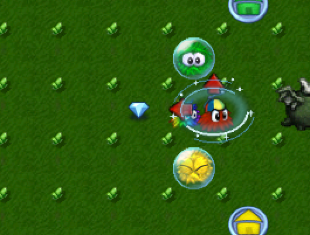
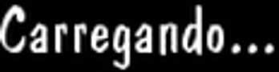

# Iggle Pop: Fuzzle Frenzy Edition

**Um mod de fã para Iggle Pop! Deluxe da Steam.** Resgate os Iggles em 16:9, jogue em português ou espanhol e monte suas próprias fases dentro do jogo.

[Baixar o patch para Windows](../../releases/latest) · [English overview](#english-overview)

## O que mudou

| Área | O que entrou no mod |
| --- | --- |
| Vídeo | Campo de jogo em 16:9, opções de resolução até 1920 × 1080, modo sem bordas e AMD FSR 1 opcional. |
| Apresentação | Arte original com ajustes de nitidez. HUD reposicionado, fundos e enfeites nas laterais, efeitos de fase estendidos e avisos centralizados. |
| Idiomas | Inglês, português brasileiro e espanhol, com seleção pelo menu do jogo. Diálogos, nomes de fases, avisos, carregamento e artes de interface adaptados. |
| Controles e áudio | WASD, setas e controle compatível com Windows. Navegação nos menus, turbo, pausa e controles separados para volume e liga/desliga de efeitos e música. |
| Fases personalizadas | Biblioteca e editor internos, com seleção de tema, paredes, pisos, decoração, casas e gaiolas por cor, inimigos e poderes. Dá para testar, salvar, salvar como e apagar uma fase pelo jogo. |
| Conteúdo restaurado | Rainbows, coleta de tempo lento, Blobby laranja com olhos animados e trilha própria, e Dragão com fogo roxo que desacelera o herói. |
| Correções | Alinhamento de cliques em 16:9, avisos de bônus e conclusão, transições de volta ao menu e separação entre o progresso da campanha e o teste de fases próprias. |

## Por dentro do mod

### Campo aberto em 16:9

O placar foi para a borda direita e o espaço extra foi integrado ao cenário, com fundos, enfeites e partículas ocupando as laterais. Os personagens mantêm as proporções originais. O FSR 1 é uma opção do menu de vídeo para quem prefere a imagem mais nítida.

### Opções no estilo do jogo

As barras usam segmentos pequenos dentro do painel para caber com folga ao lado das caixinhas originais. A caixinha silencia o canal e guarda o volume escolhido. O **OK** fecha a janela. No controle, o direcional seleciona, **A** confirma, **B** volta e o analógico direito movimenta o cursor.

### Uma oficina dentro do jogo

A biblioteca reúne **Jogar**, **Editar**, **Nova** e **Apagar**. As fases criadas são salvas na pasta `CustomLevels` da instalação. Dá para testar uma fase e voltar ao menu sem avançar a campanha.

O tabuleiro fica à esquerda e as ferramentas ficam numa coluna à direita, com prévia, cores e ações de arquivo. O visual remete ao editor interno do jogo e deixa o mapa à vista durante a edição. Pressione **Y** no controle para alternar entre tabuleiro e ferramentas.

A paleta permite escolher o poder antes de colocá-lo no chão. Os cinco temas reaproveitam a linguagem visual de jardim, neve, deserto, caverna e nave.

### Rainbow, diamantes e o brilho do herói

Os Rainbows seguem a fila como os outros Iggles. De vez em quando, um deles deixa um diamante no caminho, então vale passar de novo por um trecho já explorado. Ao recolher três, o herói ganha **sete segundos** de aura luminosa que desacelera os vilões próximos. Os brilhos indicam que o efeito está ativo.

O **Blobby** tem corpo laranja, olhos animados e uma trilha própria. O **Dragão** tem movimento e animação de ataque próprios. O fogo roxo desacelera o jogador por um curto período. Esses elementos vão nas fases personalizadas.

### Tradução também na arte

O selo de gelo mantém a silhueta irregular e o contorno azul. O texto da tela de carregamento também foi redesenhado para ficar legível no mesmo estilo do jogo.

## Instalação

1. Instale o **Iggle Pop! Deluxe da Steam** e feche o jogo.
2. Baixe `Iggle-Pop-Fuzzle-Frenzy-Edition-v24.exe` na [release](../../releases/latest).
3. Abra o instalador e selecione a pasta do jogo.
4. Inicie pela Steam. Use **Opções** para vídeo, áudio e controles, **Idioma** para tradução e **Fases personalizadas** para jogar ou editar mapas.

O instalador valida os arquivos da edição Steam, faz uma cópia dos arquivos que substitui em `IgglePop-HD-original` e aplica o patch sobre a instalação existente. O download contém o mod e requer os arquivos do jogo. A versão v24 é para um jogador.

## English overview

**Fuzzle Frenzy Edition** is a Windows fan mod for the Steam edition of **Iggle Pop! Deluxe**. It brings a 16:9 playfield, up to 1080p, optional AMD FSR 1, controller and WASD support, separate effects and music volume, and English, Brazilian Portuguese and Spanish. The built-in level editor includes custom themes, enemies, pickups and playtesting. Rare Rainbow diamonds charge a seven-second aura that slows nearby enemies. Download the patch from [Releases](../../releases/latest) and point the installer to your Steam game folder.

## Créditos

- **Iggle Pop! Deluxe** e sua arte original pertencem aos respectivos criadores e titulares. Esta é uma edição de fã independente.
- A camada de vídeo deriva de [cnc-ddraw](https://github.com/FunkyFr3sh/cnc-ddraw), com a [licença MIT](LICENSE) preservada.
- O código inclui AMD FidelityFX Super Resolution 1. Consulte a [licença da AMD](docs/licenses/AMD-FSR-LICENSE.txt).
- O fonte do renderizador e do instalador está neste repositório. A release inclui os recursos do mod aplicados pelo instalador. Consulte as [instruções de compilação](docs/BUILD.md) para gerar o renderizador.

