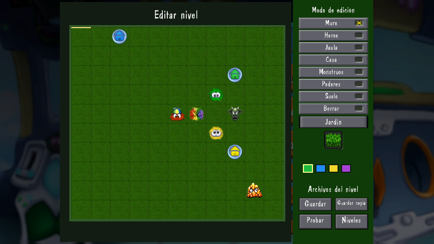

# Iggle Pop: Fuzzle Frenzy Edition

**A fan mod for the Steam edition of Iggle Pop! Deluxe.** Rescue Iggles in widescreen, play in English, Brazilian Portuguese or Spanish, and build your own stages inside the game.

[Download the Windows patch](https://github.com/canneli/iggle-pop-fuzzle-frenzy-edition/releases/latest) · [Português (Brasil)](#português-brasil)

## What’s new

| Area | Changes |
| --- | --- |
| Video | A 16:9 playfield, resolutions up to 1920 × 1080, borderless mode and optional AMD FSR 1. |
| Presentation | Sharper original artwork, a repositioned HUD, scenery and particles across the wider playfield, and centered messages. |
| Languages | English, Brazilian Portuguese and Spanish, selectable in-game. The localization covers dialogue, stage names, notices, loading text and interface artwork. |
| Controls and audio | WASD, arrow keys and compatible Windows controllers. Controller navigation, boost and pause, plus separate volume and mute controls for sound effects and music. |
| Custom stages | In-game stage library and editor with themes, walls, floor tiles, decorations, color-coded homes and cages, enemies and power-ups. Playtest, save, save as and delete stages from inside the game. |
| Restored content | Rainbow Iggles, a time-slow pickup, an orange Blobby with animated eyes and its own trail, and a Dragon whose purple fire slows the hero. |
| Fixes | Widescreen click targets, bonus and stage-clear messages, menu transitions, and campaign progress kept separate from custom stage playtests. |

## A closer look

### A wider playfield

The scoreboard moves to the right edge, while backgrounds, decorations and particles fill the extra space. Characters keep their original proportions. FSR 1 can be enabled in the video menu for a sharper image.

### Audio controls that fit the original menu

Short, segmented sliders sit beside the original checkboxes. Each checkbox mutes its channel while keeping the chosen volume, and **OK** closes the panel. On a controller, the D-pad moves between buttons, **A** confirms, **B** goes back and the right stick moves the pointer.

### An in-game workshop

The library puts **Play**, **Edit**, **New** and **Delete** together. Stages you create are saved in the game's `CustomLevels` folder. You can test a stage and return to the menu without advancing the campaign.

The map stays visible on the left while tools, previews, colors and file actions sit in a column on the right. The layout takes its cues from the game's built-in editor. Press **Y** on a controller to switch between the board and the tools.

The picker lets you choose which power-up to place on the board. The five stage themes draw on the original garden, snow, desert, cave and spaceship settings.

### Rainbows, diamonds and the hero’s glow

Rainbows join the line like the other Iggles. Occasionally, one leaves a diamond behind, giving you a reason to revisit part of the maze. Collect three to activate a **seven-second** aura that slows nearby enemies. The ring of light and sparks shows when the effect is active.

**Blobby** has an orange body, animated eyes and its own trail. The **Dragon** has its own movement and attack animations. Its purple fire briefly slows the player. Both appear in custom stages.

### Localized artwork

The localized Freeze badges keep the jagged silhouette and blue outline. The loading lettering was also redrawn for readability in the original game's style.

## Installation

1. Install **Iggle Pop! Deluxe on Steam** and close the game.
2. Download `Iggle-Pop-Fuzzle-Frenzy-Edition-v24.exe` from the [latest release](https://github.com/canneli/iggle-pop-fuzzle-frenzy-edition/releases/latest).
3. Run the installer and select your Steam game folder.
4. Launch from Steam. Open **Options** for video, audio and controls, **Language** to choose a translation, or **Custom Levels** to play and edit stages.

The installer checks the Steam game files and backs up the files it replaces in `IgglePop-HD-original`. The patch requires an existing Steam installation. Version v24 is single-player.

## Credits

- **Iggle Pop! Deluxe** and its original artwork belong to their respective creators and rights holders. This is an independent fan project.
- The renderer is based on [cnc-ddraw](https://github.com/FunkyFr3sh/cnc-ddraw) and retains its [MIT license](LICENSE).
- The code includes AMD FidelityFX Super Resolution 1. See the [AMD license](docs/licenses/AMD-FSR-LICENSE.txt).
- This repository contains the renderer and installer source. The release includes the patch resources. See the [build instructions](docs/BUILD.md) for the renderer.

---

## Português (Brasil)

**Um mod de fã para Iggle Pop! Deluxe da Steam.** Resgate os Iggles em 16:9, jogue em português ou espanhol e monte suas próprias fases dentro do jogo.

[Baixar o patch para Windows](https://github.com/canneli/iggle-pop-fuzzle-frenzy-edition/releases/latest)

### O que mudou

| Área | O que entrou no mod |
| --- | --- |
| Vídeo | Campo de jogo em 16:9, opções de resolução até 1920 × 1080, modo sem bordas e AMD FSR 1 opcional. |
| Apresentação | Arte original com ajustes de nitidez. HUD reposicionado, fundos e enfeites nas laterais, efeitos de fase estendidos e avisos centralizados. |
| Idiomas | Inglês, português brasileiro e espanhol, com seleção pelo menu do jogo. Diálogos, nomes de fases, avisos, carregamento e artes de interface adaptados. |
| Controles e áudio | WASD, setas e controle compatível com Windows. Navegação nos menus, turbo, pausa e controles separados para volume e liga/desliga de efeitos e música. |
| Fases personalizadas | Biblioteca e editor internos, com seleção de tema, paredes, pisos, decoração, casas e gaiolas por cor, inimigos e poderes. Dá para testar, salvar, salvar como e apagar uma fase pelo jogo. |
| Conteúdo restaurado | Rainbows, coleta de tempo lento, Blobby laranja com olhos animados e trilha própria, e Dragão com fogo roxo que desacelera o herói. |
| Correções | Alinhamento de cliques em 16:9, avisos de bônus e conclusão, transições de volta ao menu e separação entre o progresso da campanha e o teste de fases próprias. |

### Por dentro do mod

#### Campo aberto em 16:9

O placar foi para a borda direita e o espaço extra foi integrado ao cenário, com fundos, enfeites e partículas ocupando as laterais. Os personagens mantêm as proporções originais. O FSR 1 é uma opção do menu de vídeo para quem prefere a imagem mais nítida.

#### Opções no estilo do jogo

As barras usam segmentos pequenos dentro do painel para caber com folga ao lado das caixinhas originais. A caixinha silencia o canal e guarda o volume escolhido. O **OK** fecha a janela. No controle, o direcional seleciona, **A** confirma, **B** volta e o analógico direito movimenta o cursor.

#### Uma oficina dentro do jogo

A biblioteca reúne **Jogar**, **Editar**, **Nova** e **Apagar**. As fases criadas são salvas na pasta `CustomLevels` da instalação. Dá para testar uma fase e voltar ao menu sem avançar a campanha.

O tabuleiro fica à esquerda e as ferramentas ficam numa coluna à direita, com prévia, cores e ações de arquivo. O visual remete ao editor interno do jogo e deixa o mapa à vista durante a edição. Pressione **Y** no controle para alternar entre tabuleiro e ferramentas.

A paleta permite escolher o poder antes de colocá-lo no chão. Os cinco temas reaproveitam a linguagem visual de jardim, neve, deserto, caverna e nave.

#### Rainbow, diamantes e o brilho do herói

Os Rainbows seguem a fila como os outros Iggles. De vez em quando, um deles deixa um diamante no caminho, então vale passar de novo por um trecho já explorado. Ao recolher três, o herói ganha **sete segundos** de aura luminosa que desacelera os vilões próximos. Os brilhos indicam que o efeito está ativo.

O **Blobby** tem corpo laranja, olhos animados e uma trilha própria. O **Dragão** tem movimento e animação de ataque próprios. O fogo roxo desacelera o jogador por um curto período. Esses elementos vão nas fases personalizadas.

#### Tradução também na arte

O selo de gelo mantém a silhueta irregular e o contorno azul. O texto da tela de carregamento também foi redesenhado para ficar legível no mesmo estilo do jogo.

### Instalação

1. Instale o **Iggle Pop! Deluxe da Steam** e feche o jogo.
2. Baixe `Iggle-Pop-Fuzzle-Frenzy-Edition-v24.exe` na [release](https://github.com/canneli/iggle-pop-fuzzle-frenzy-edition/releases/latest).
3. Abra o instalador e selecione a pasta do jogo.
4. Inicie pela Steam. Use **Opções** para vídeo, áudio e controles, **Idioma** para tradução e **Fases personalizadas** para jogar ou editar mapas.

O instalador valida os arquivos da edição Steam, faz uma cópia dos arquivos que substitui em `IgglePop-HD-original` e aplica o patch sobre a instalação existente. O download contém o mod e requer os arquivos do jogo. A versão v24 é para um jogador.

### Créditos

- **Iggle Pop! Deluxe** e sua arte original pertencem aos respectivos criadores e titulares. Esta é uma edição de fã independente.
- A camada de vídeo deriva de [cnc-ddraw](https://github.com/FunkyFr3sh/cnc-ddraw), com a [licença MIT](LICENSE) preservada.
- O código inclui AMD FidelityFX Super Resolution 1. Consulte a [licença da AMD](docs/licenses/AMD-FSR-LICENSE.txt).
- O fonte do renderizador e do instalador está neste repositório. A release inclui os recursos do mod aplicados pelo instalador. Consulte as [instruções de compilação](docs/BUILD.md) para gerar o renderizador.
