# Iggle Pop: Fuzzle Frenzy Edition

**Iggle Pop: Fuzzle Frenzy Edition is a Windows fan mod for Iggle Pop! Deluxe on Steam.** Play in 1080p widescreen with controller or WASD support, build custom stages in the in-game level editor, and try restored content from the original game: Rainbow Iggles, a time-slow pickup and a Dragon enemy. Play in English, Brazilian Portuguese or Spanish. Includes a character remake, English/Portuguese Fuzzle voices and in-game speech balloons.

[Download the Windows patch](https://github.com/canneli/iggle-pop-fuzzle-frenzy-edition/releases/latest) · [Português (Brasil)](#português-brasil)

## What’s new

| Area | Changes |
| --- | --- |
| Video | A 16:9 playfield, resolutions up to 1920 × 1080, borderless mode and optional AMD FSR 1. |
| Presentation | Sharper original artwork, a repositioned HUD, scenery and particles across the wider playfield, and centered messages. |
| Languages | English, Brazilian Portuguese and Spanish, selectable in-game. The localization covers dialogue, stage names, notices, loading text and interface artwork. |
| Controls and audio | WASD, arrow keys and compatible Windows controllers. Controller navigation, boost and pause, plus separate volume and mute controls for sound effects and music. |
| Custom stages | In-game stage library and editor with themes, walls, floor tiles, decorations, color-coded homes and cages, enemies and power-ups. Playtest, save, save as and delete stages from inside the game. |
| Mods | Load custom worlds and Fizzy skins from the in-game Mods menu. Sugar Grove and Pink Bow Fizzy are included. |
| Restored content | Rainbow Iggles, a time-slow pickup, an orange Blobby with animated eyes and its own trail, and a Dragon whose purple fire slows the hero. |
| Fixes | Widescreen click targets, bonus and stage-clear messages, menu transitions, and campaign progress kept separate from custom stage playtests. |

## A closer look

### Character remake and Fuzzle voices — v34

The character remake replaces 210 sprite frames and their paired transparency masks while preserving the native canvas sizes, pivots and character proportions. This preview shows replacement artwork, rather than a gameplay screenshot.

Fuzzle colors have distinct expressions in both trapped and freed poses: curious green, calmer blue, determined yellow, grumpy orange and cheerful Rainbow. Directional sprites keep the expression appropriate to the visible face.

The new **English and Brazilian Portuguese voice lines** are supplied by the mod author. All eight clips together use **111 KB (about 109 KiB)** as mono OGG Vorbis at 22.05 kHz. In-game language selection chooses the matching voice set; Spanish interface text remains available with English voice fallback.

| Moment | Voice line |
| --- | --- |
| A stage begins | A random trapped Fuzzle calls “Hey! Over here!” |
| The native unassisted break-free event | “I lost you! Where'd you go?”; ordinary player rescues and home deliveries do not trigger it. |
| Only a few trapped Fuzzles remain | “Wait! I'm still in here!” |
| An occasional plea during a stage | “Help! I'm stuck in this bubble!” |

Oval speech balloons with red lettering and small trailing bubbles identify the speaker and follow the selected English or Portuguese dialogue. They are reconstructed from the supplied reference in the game's renderer. Mouth movement follows the audio when the front or side of the face is visible.

**v34 restores the original Fuzzle cheers, “yuhull” sounds and reactions.** The new dialogue is an addition to those sounds. Delivering a speaking Fuzzle lets its sentence finish; stage exits and pause stop the line. New dialogue lines do not overlap each other and use the sound-effects volume control.

The installer includes the earlier Fuzzle Frenzy changes, preserves existing saves, custom stages and video settings, and keeps overwritten files in `FuzzleFrenzy-Remake-Voices-backup-v34`. The final balloon and restored-sound revision is available for player testing.

### A wider playfield

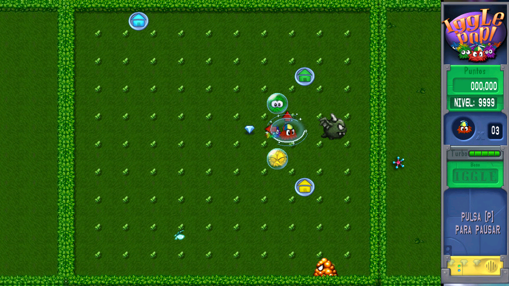

The scoreboard moves to the right edge, while backgrounds, decorations and particles fill the extra space. Characters keep their original proportions. FSR 1 can be enabled in the video menu for a sharper image.

### Audio controls that fit the original menu

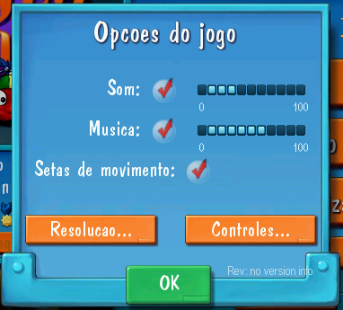

Short, segmented sliders sit beside the original checkboxes. Each checkbox mutes its channel while keeping the chosen volume, and **OK** closes the panel. On a controller, the D-pad moves between buttons, **A** confirms, **B** goes back and the right stick moves the pointer.

### An in-game workshop

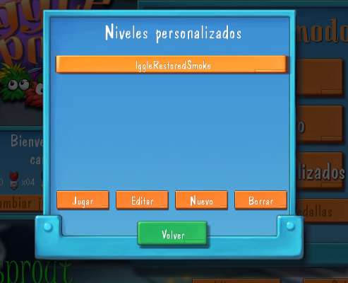

The library puts **Play**, **Edit**, **New** and **Delete** together. Stages you create are saved in the game's `CustomLevels` folder. You can test a stage and return to the menu without advancing the campaign.

The map stays visible on the left while tools, previews, colors and file actions sit in a column on the right. The original game archive contains a disabled level editor. The mod brings level editing into the game through a panel inspired by those assets, with tools for walls, floors, monsters and power-ups, as well as themes, colors and level parameters. Press **Y** on a controller to switch between the board and the tools.

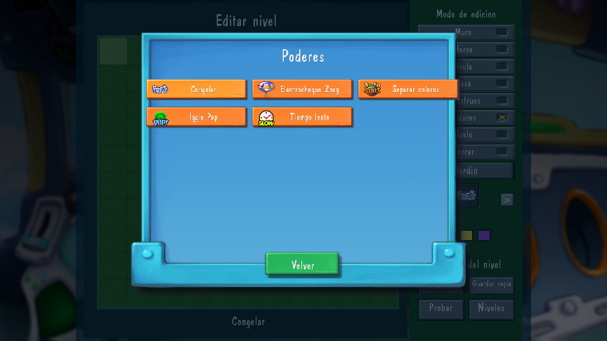

The picker lets you choose which power-up to place on the board. The five stage themes draw on the original garden, snow, desert, cave and spaceship settings.

### Sugar Grove and the in-game mod loader

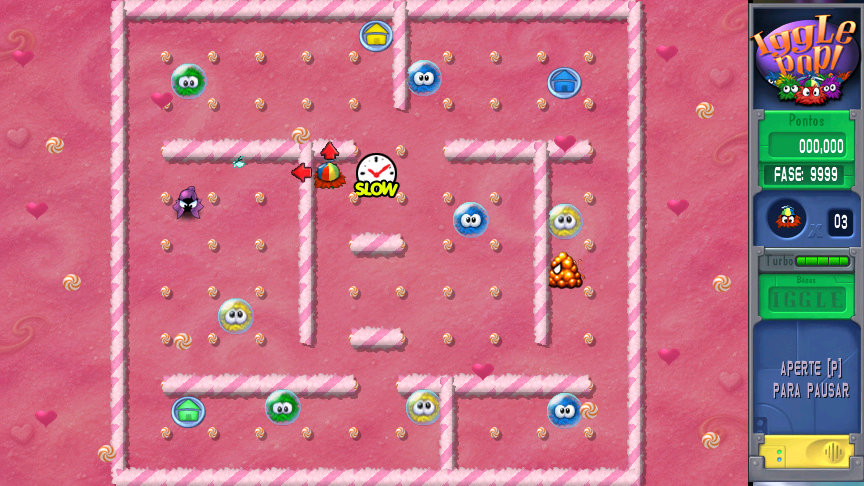

Sugar Grove is a playable pink candy maze. The patch also includes Pink Bow Fizzy, a skin that uses Fizzy's existing moves and attributes.

The airship in Level 26 has a sky behind the deck, with clouds moving across both sides. Level decorations follow the maze in widescreen.

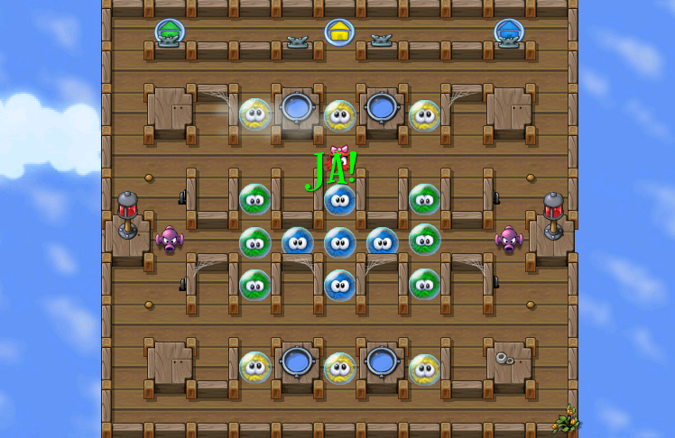

Drop a `.igglemod` file into the `mods` folder in the game directory and reopen **Mods** on the main menu. Enable a world and select **Play world**. The active world also appears in the level editor's theme selector. You can enable one world and one Fizzy skin together. Restart the game after changing skins to reload the sprites. [Mod authoring guide](docs/MODS.md)

### Rainbow Iggles

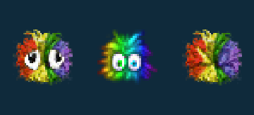

The original game archive includes two unused cage sprites for a rainbow color. In custom stages, freed Rainbows join the line and occasionally drop a blue diamond. The south-facing walking sprite has a wider-eyed expression than the caged version.

### Time-slow pickup

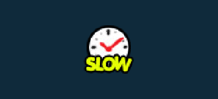

The unused slow-pickup sprite is available as a placeable power-up in custom stages. In the mod, it temporarily slows the action.

### Dragon enemy

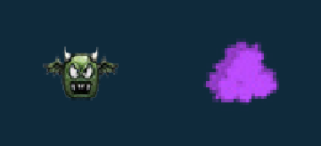

The mod adapts the unused Dragon sprite into an enemy for custom stages, with directional animations and a purple fireball that briefly slows the hero.

The [unused graphics and editor notes at The Cutting Room Floor](https://tcrf.net/Iggle_Pop!) document the original assets that inspired these additions.

### Blobby

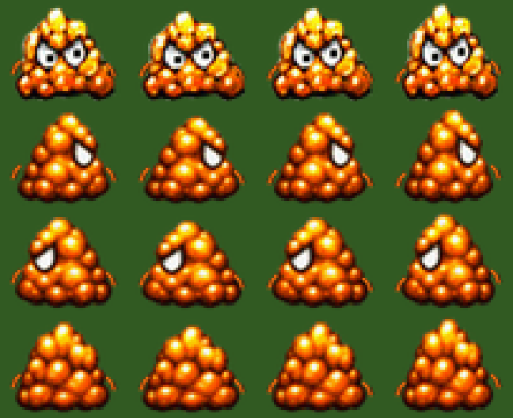

Blobby has a fuller orange body, animated eyes, a larger editor portrait and a trail of amber bubbles inspired by the Tracker.

### Blue diamonds and crystal shield

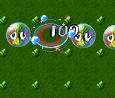

Blue diamonds still award points. Collect three to slow all enemies for five seconds and equip a shield that stays until it absorbs a fatal hit. Orbiting diamonds and a short chime signal activation. When the shield breaks, the hero keeps moving with the game's standard 2.5-second protection window.

### Localized artwork

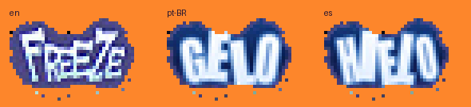

The localized Freeze badges keep the jagged silhouette and blue outline. The loading lettering was also redrawn for readability in the original game's style.

## Installation

1. Install **Iggle Pop! Deluxe on Steam** and close the game.
2. Download `Iggle-Pop-Fuzzle-Frenzy-Remake-Vozes-v34.exe` from the [latest release](https://github.com/canneli/iggle-pop-fuzzle-frenzy-edition/releases/latest).
3. Run the installer and select your Steam game folder.
4. Launch from Steam. Open **Options** for video, audio and controls, **Language** to choose a translation, or **Custom Levels** to play and edit stages.

The installer checks the Steam game files and backs up the files it replaces in `IgglePop-HD-original`. The patch requires an existing Steam installation.

## Credits

- OGG dialogue playback uses [stb_vorbis](https://github.com/nothings/stb), with the [MIT license preserved](docs/licenses/stb_vorbis.txt).
- **Iggle Pop! Deluxe** and its original artwork belong to their respective creators and rights holders. This is an independent fan project.
- The renderer is based on [cnc-ddraw](https://github.com/FunkyFr3sh/cnc-ddraw) and retains its [MIT license](LICENSE).
- The code includes AMD FidelityFX Super Resolution 1. See the [AMD license](docs/licenses/AMD-FSR-LICENSE.txt).
- This repository contains the renderer and installer source. The release includes the patch resources. See the [build instructions](docs/BUILD.md) for the renderer.

---

## Português (Brasil)

### Remake dos personagens e vozes dos Fuzzles — v34

O remake troca 210 quadros de sprites e suas máscaras de transparência, mantendo tamanho de tela, pontos de apoio e proporções dos personagens. As imagens desta seção são prévias das artes.

Cada cor tem uma expressão própria, dentro e fora da bolha: verde curioso, azul tranquilo, amarelo determinado, laranja emburrado e Rainbow alegre.

As falas criadas pelo autor estão em **inglês e português brasileiro**. Os oito arquivos usam OGG Vorbis mono a 22.050 Hz e somam **111 KB (cerca de 109 KiB)**. O idioma escolhido no jogo seleciona as vozes correspondentes. A interface em espanhol continua disponível, com vozes em inglês.

| Momento | Fala |
| --- | --- |
| Início da fase | Um Fuzzle preso aleatório chama “Ei! Aqui!” |
| Evento original de fuga da bolha sem ajuda | “Te perdi! Cadê você?”; resgates normais e entregas na casa não disparam essa fala. |
| Poucos Fuzzles ainda presos | “Espera! Ainda tô aqui dentro!” |
| Pedido ocasional durante a fase | “Socorro! Tô preso nessa bolha!” |

Os balões ovais, com letras vermelhas e bolhinhas apontando para o personagem, acompanham quem fala e mostram o texto no idioma escolhido. Foram reconstruídos no renderizador com base na referência enviada. A boca acompanha o áudio quando a frente ou o lado do rosto está visível.

**A v34 devolve os “yuhull”, as comemorações e as reações originais dos Fuzzles.** As falas novas complementam esses sons. Entregar o Fuzzle durante uma frase deixa o áudio terminar; pausar ou sair da fase interrompe a fala. As falas novas não se sobrepõem entre si e acompanham o volume dos efeitos sonoros.

O instalador reúne as alterações anteriores da Fuzzle Frenzy, preserva saves, fases personalizadas e configurações de vídeo existentes e guarda os arquivos substituídos em `FuzzleFrenzy-Remake-Voices-backup-v34`. Esta revisão final dos balões e sons restaurados está disponível para teste dos jogadores.

**Iggle Pop: Fuzzle Frenzy Edition é um mod para Iggle Pop! Deluxe da Steam no Windows.** Jogue em 1080p com tela 16:9, use controle ou WASD e crie mapas no editor de fases integrado. A tradução inclui português brasileiro e espanhol, e as fases personalizadas podem usar os Iggles arco-íris, o poder de tempo lento e o Dragão.

[Baixar o patch para Windows](https://github.com/canneli/iggle-pop-fuzzle-frenzy-edition/releases/latest)

### O que mudou

| Área | O que entrou no mod |
| --- | --- |
| Vídeo | Campo de jogo em 16:9, opções de resolução até 1920 × 1080, modo sem bordas e AMD FSR 1 opcional. |
| Apresentação | Arte original com ajustes de nitidez. HUD reposicionado, fundos e enfeites nas laterais, efeitos de fase estendidos e avisos centralizados. |
| Idiomas | Inglês, português brasileiro e espanhol, com seleção pelo menu do jogo. Diálogos, nomes de fases, avisos, carregamento e artes de interface adaptados. |
| Controles e áudio | WASD, setas e controle compatível com Windows. Navegação nos menus, turbo, pausa e controles separados para volume e liga/desliga de efeitos e música. |
| Fases personalizadas | Biblioteca e editor internos, com seleção de tema, paredes, pisos, decoração, casas e gaiolas por cor, inimigos e poderes. Dá para testar, salvar, salvar como e apagar uma fase pelo jogo. |
| Mods | Carregue mundos personalizados e visuais do Fizzy pelo menu Mods. O Bosque de Açúcar e o Pink Bow Fizzy vêm no patch. |
| Conteúdo restaurado | Rainbows, coleta de tempo lento, Blobby laranja com olhos animados e trilha própria, e Dragão com fogo roxo que desacelera o herói. |
| Correções | Alinhamento de cliques em 16:9, avisos de bônus e conclusão, transições de volta ao menu e separação entre o progresso da campanha e o teste de fases próprias. |

### Por dentro do mod

#### Campo aberto em 16:9

O placar foi para a borda direita e o espaço extra foi integrado ao cenário, com fundos, enfeites e partículas ocupando as laterais. Os personagens mantêm as proporções originais. O FSR 1 é uma opção do menu de vídeo para quem prefere a imagem mais nítida.

#### Opções no estilo do jogo

As barras usam segmentos pequenos dentro do painel para caber com folga ao lado das caixinhas originais. A caixinha silencia o canal e guarda o volume escolhido. O **OK** fecha a janela. No controle, o direcional seleciona, **A** confirma, **B** volta e o analógico direito movimenta o cursor.

#### Uma oficina dentro do jogo

A biblioteca reúne **Jogar**, **Editar**, **Nova** e **Apagar**. As fases criadas são salvas na pasta `CustomLevels` da instalação. Dá para testar uma fase e voltar ao menu sem avançar a campanha.

O tabuleiro fica à esquerda e as ferramentas ficam numa coluna à direita, com prévia, cores e ações de arquivo. O arquivo de recursos do jogo original contém um editor de fases desativado. O mod usa essa interface como referência para um editor integrado, com ferramentas de paredes, pisos, inimigos e poderes, além de temas, cores e parâmetros da fase. Pressione **Y** no controle para alternar entre tabuleiro e ferramentas.

A paleta permite escolher o poder antes de colocá-lo no chão. Os cinco temas reaproveitam a linguagem visual de jardim, neve, deserto, caverna e nave.

#### Bosque de Açúcar e carregador de mods

O Bosque de Açúcar é um labirinto rosa jogável. O patch também inclui o Pink Bow Fizzy, com pelo vermelho e lacinho rosa. Na fase 26, as nuvens passam atrás do convés e as lanternas acompanham o labirinto em 16:9.

Coloque o arquivo `.igglemod` na pasta `mods` da instalação e reabra **Mods** no menu inicial. Ative o mundo e escolha **Jogar mundo**. O tema ativo também aparece no seletor do editor de fases. Dá para ativar um mundo e um visual ao mesmo tempo. Reinicie o jogo depois de trocar de visual para recarregar os sprites. [Guia para criar mods](docs/MODS.md#português-brasil)

#### Iggles arco-íris

O arquivo original inclui dois sprites de gaiola de uma cor arco-íris que ficou sem uso. Nas fases personalizadas, os Rainbows libertados entram na fila e às vezes deixam cair um diamante azul. O sprite de caminhada para baixo tem os olhos mais abertos que a versão da gaiola.

#### Poder de tempo lento

A arte descartada do item de lentidão virou um poder que pode ser colocado no chão pelo editor. No mod, ele desacelera temporariamente a ação.

#### Dragão

O mod adaptou o sprite descartado do Dragão para as fases personalizadas, com animações em várias direções e uma bola de fogo roxa que desacelera o herói por um curto período.

As [notas de The Cutting Room Floor sobre a arte descartada e o editor](https://tcrf.net/Iggle_Pop!) registram os recursos originais que inspiraram essas adições.

#### Blobby

O Blobby tem corpo laranja mais cheio, olhos animados, miniatura maior no editor e uma trilha de bolhas cor de âmbar inspirada no Rastreador.

#### Diamantes azuis e escudo de cristais

Os diamantes azuis continuam dando pontos. Ao juntar três, todos os inimigos ficam mais lentos por cinco segundos e o escudo permanece até absorver um golpe fatal. Três diamantes em órbita e um som curto indicam a ativação. Quando o escudo quebra, o herói continua sob seu controle e recebe os 2,5 segundos de proteção padrão do jogo.

#### Tradução também na arte

O selo de gelo mantém a silhueta irregular e o contorno azul. O texto da tela de carregamento também foi redesenhado para ficar legível no mesmo estilo do jogo.

### Instalação

1. Instale o **Iggle Pop! Deluxe da Steam** e feche o jogo.
2. Baixe `Iggle-Pop-Fuzzle-Frenzy-Remake-Vozes-v34.exe` na [release](https://github.com/canneli/iggle-pop-fuzzle-frenzy-edition/releases/latest).
3. Abra o instalador e selecione a pasta do jogo.
4. Inicie pela Steam. Use **Opções** para vídeo, áudio e controles, **Idioma** para tradução e **Fases personalizadas** para jogar ou editar mapas.

O instalador valida os arquivos da edição Steam, faz uma cópia dos arquivos que substitui em `IgglePop-HD-original` e aplica o patch sobre a instalação existente. O download contém o mod e requer os arquivos do jogo.

### Créditos

- A reprodução das falas OGG usa [stb_vorbis](https://github.com/nothings/stb), com a [licença MIT preservada](docs/licenses/stb_vorbis.txt).
- **Iggle Pop! Deluxe** e sua arte original pertencem aos respectivos criadores e titulares. Esta é uma edição de fã independente.
- A camada de vídeo deriva de [cnc-ddraw](https://github.com/FunkyFr3sh/cnc-ddraw), com a [licença MIT](LICENSE) preservada.
- O código inclui AMD FidelityFX Super Resolution 1. Consulte a [licença da AMD](docs/licenses/AMD-FSR-LICENSE.txt).
- O fonte do renderizador e do instalador está neste repositório. A release inclui os recursos do mod aplicados pelo instalador. Consulte as [instruções de compilação](docs/BUILD.md) para gerar o renderizador.
