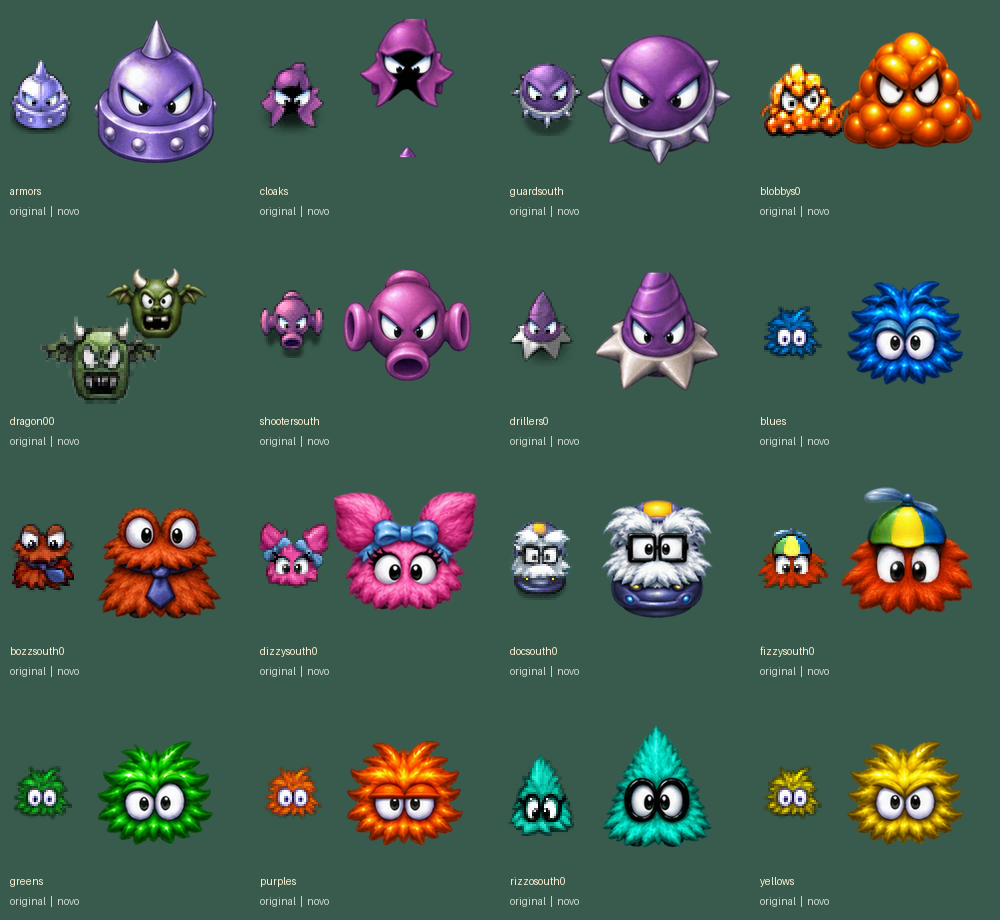
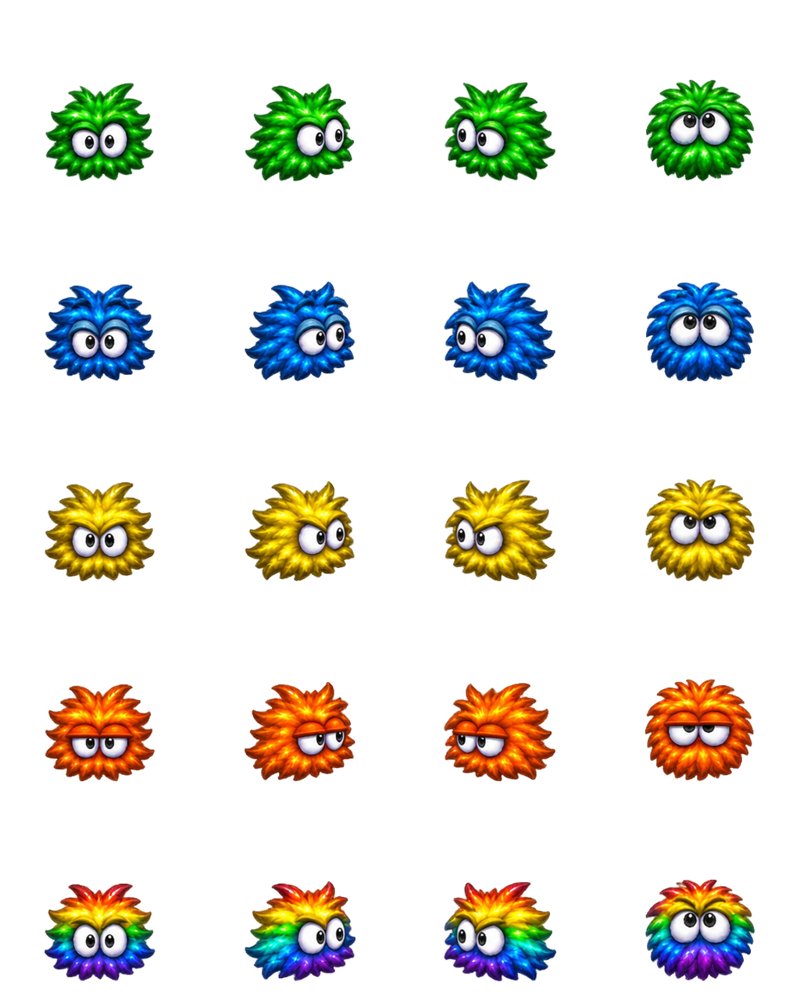

## English

### Character remake, English/Portuguese voices and original cheers

- Includes the character remake with 210 replacement frames and paired transparency masks, including distinct expressions for trapped and freed Fuzzles.
- Adds eight author-supplied voice clips in English and Brazilian Portuguese. OGG Vorbis mono, 22.05 kHz; **111,071 bytes total**.
- A random trapped Fuzzle calls at stage start; native unassisted break-free, few remaining trapped Fuzzles and occasional pleas have their own lines.
- Adds translated in-game speech balloons that follow the speaker and audio-driven mouth movement on visible faces. Balloons are reconstructed from the reference rather than recovered source sprites.
- **Restores the original Fuzzle cheers, “yuhull” sounds and reactions.** New dialogue complements the game's original sounds.
- Home delivery no longer cuts a sentence short or incorrectly triggers the lost-Fuzzle line. New lines are serialized; pause and stage exits stop playback.
- Includes the earlier widescreen, resolution, FSR, localization, controller/WASD, integrated editor and mod-loader changes.
- Preserves existing saves, custom stages, mod selections and video settings. Replaced files are backed up in `FuzzleFrenzy-Remake-Voices-backup-v34`.

### Download and install

1. Close Iggle Pop! Deluxe.
2. Download **Iggle-Pop-Fuzzle-Frenzy-Remake-Vozes-v34.exe** below and select your Steam game folder.
3. Launch normally through Steam. Choose English or Português in the in-game Language menu.

The patch requires the compatible Steam game files. Validation covers the Windows build, OGG decoding and package integrity. Full gameplay coverage of the final balloon and restored-sound revision remains open for player feedback. A SHA-256 checksum and installation notes are attached.

## Português (Brasil)

### Remake, vozes em inglês/português e gritinhos originais

- Inclui o remake com 210 quadros e suas máscaras de transparência, com expressões diferentes para os Fuzzles presos e libertados.
- Adiciona oito falas criadas pelo autor, em inglês e português brasileiro. OGG Vorbis mono, 22.050 Hz; **111.071 bytes no total**.
- Um Fuzzle preso aleatório chama no início da fase. A fuga original da bolha sem ajuda, os últimos Fuzzles presos e os pedidos ocasionais têm falas próprias.
- Adiciona balões traduzidos que acompanham o personagem e movimento de boca guiado pelo áudio quando o rosto está visível. Os balões foram reconstruídos pela referência.
- **Devolve os “yuhull”, as comemorações e as reações originais dos Fuzzles.** As falas novas complementam os sons do jogo.
- Entregar o Fuzzle não corta mais a frase nem dispara incorretamente a fala de “te perdi”. As falas novas não se sobrepõem entre si; pausa e saída da fase interrompem o áudio.
- Reúne as alterações anteriores de tela larga, resolução, FSR, idiomas, controle/WASD, editor integrado e carregador de mods.
- Preserva saves, fases personalizadas, seleção de mods e configurações de vídeo existentes. Os arquivos substituídos ficam em `FuzzleFrenzy-Remake-Voices-backup-v34`.

### Como instalar

1. Feche o Iggle Pop! Deluxe.
2. Baixe **Iggle-Pop-Fuzzle-Frenzy-Remake-Vozes-v34.exe** abaixo e selecione a pasta do jogo da Steam.
3. Inicie normalmente pela Steam. Escolha Português ou English em Idioma.

O patch requer os arquivos da edição Steam compatível. A validação cobre a compilação para Windows, a leitura dos OGG e a integridade do pacote. A revisão final dos balões e sons restaurados está aberta ao teste dos jogadores. O checksum SHA-256 e as instruções estão anexos.
